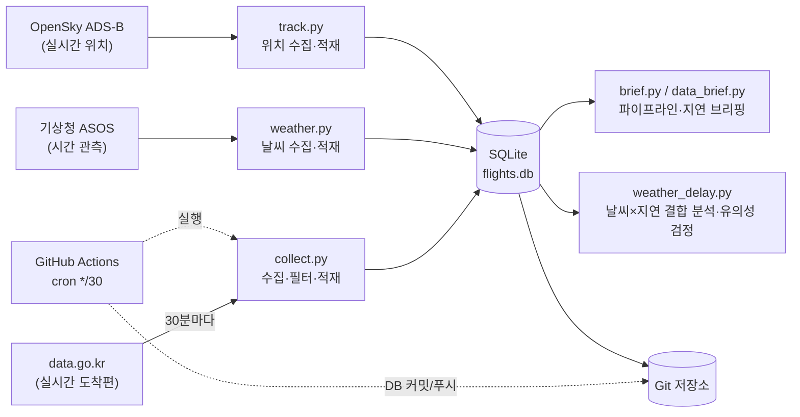

# ✈️ flight-delay-pipeline

> 김포공항(GMP) 실시간 도착편과 날씨를 **30분마다 자동 수집**하고, 편별 상태 변화를 시계열로 축적해 **"날씨가 나쁠 때 지연이 정말 늘어나는가"** 를 데이터로 검증하는 서버리스 데이터 파이프라인


---

## 📊 핵심 발견 — 비 오면 15분+ 지연율이 2배

가장 궁금했던 질문에 데이터로 답했다: **"비가 오면 항공편 지연이 정말 늘어나는가?"**

| 날씨 | 도착편 | 평균 지연 | 지연율 (15분 초과) |
| --- | ---: | ---: | ---: |
| 🌧️ 비 온 시각 | 800편 | **+10.9분** | **27.1%** |
| ☀️ 맑은 시각 | 14,107편 | −0.6분 | **13.7%** |

- **맑을 땐 평균 0.6분 일찍** 도착하지만, **비가 오면 평균 10.9분 늦어진다.**
- 15분 넘게 지연되는 비율이 **13.7% → 27.1%로 약 2배**로 뛴다.
- **시간대 착시가 아니다** — 지연이 몰리는 오후 시간대에 비가 몰려서 생긴 결과가 아닌지
  시간대(07-11/12-15/16-19/20-22시)를 고정해서 다시 봐도, 네 구간 모두 비 올 때 지연율이
  **1.4~2.8배** 높았다. 비 그룹의 시간대 구성만 반영해 "비가 없었다면" 기대되는 지연율도
  계산해보면 13.7%로, 실제(27.1%)의 절반에 그친다.
- 시정이 10km 미만(흐림·박무)일 때도 지연율이 소폭 상승(13.6% → 19.5%)하지만, 그중 다수가
  비와 겹친 시각이라 시정 자체의 독립 효과는 아직 분리하지 못했다.

> 📌 **분석 기간** 2026.08.26 ~ 현재(자동 수집 중) · 서울(108) ASOS 관측 기준 · 도착 확정편 14,907편(날씨 매칭 기준)

<details>
<summary>표본의 한계 (솔직하게)</summary>

- **날씨 지점 대체** — 김포공항엔 ASOS 관측 지점이 없어, 약 15km 거리의 **서울(108)** 관측으로 대체했다. 비·풍속·시정 같은 광역(廣域) 기상은 동일 날씨권으로 볼 수 있으나, 김포에만 낀 국지적 안개·순간 돌풍은 실제와 다를 수 있다.
- **강풍 표본 여전히 0건** — 8/26부터 지금까지 서울 풍속이 8m/s를 넘은 시각이 한 번도 없어, 강풍-지연 관계는 아직 판단을 보류했다.
- **비 온 날짜 수가 적다** — 800편이라는 숫자는 많아 보이지만, 실제로는 **15일**의 비에 몰려 있는 표본이다. 특정 하루(10/18, 51.4mm)를 빼고 다시 봐도 배수는 1.4~2배 수준으로 유지된다.
- **상관 ≠ 인과** — "비 온 시각에 지연율이 높다"는 상관관계이지, 비가 지연의 유일한 원인이라는 뜻은 아니다. (연결편 지연, 활주로 혼잡 등 다른 요인과 겹칠 수 있음)
- **PK 설계 한계** — `flights.flight_key`가 공항공사 API의 고유번호(fid)를 그대로 쓰는데, 같은 편에 API가
  fid를 재발급하면 옛 행이 "유령 행"(상태 빈 채로 방치)으로 남는다. 도착편 분석에는 영향이 없지만
  (실제 편은 새 fid 행으로 이미 반영됨), 전체 편수 집계에선 분리해서 표시한다. 자세한 내용은 `BACKLOG.md`.

</details>

---

## 📌 프로젝트 개요

항공편 지연·결항은 "지금 몇 편이 지연됐나"보다 **"어떤 편이, 언제, 어떻게 지연으로 바뀌었나"** 가 훨씬 가치 있는 정보다.
공공데이터포털은 *현재 시점*의 스냅샷만 주기 때문에, 이 프로젝트는 그 스냅샷을 주기적으로 떠서 **변화 이력을 직접 만들어 축적**한다.

여기에 더해, 항공 지연의 큰 원인 중 하나가 날씨라고 보고 **기상 관측 데이터도 함께 수집·결합**해서, 위의 "핵심 발견"처럼 날씨와 지연의 관계를 실제로 검증했다. 더 나아가 **ADS-B 실시간 항공기 위치**까지 30분마다 찍어 쌓아, 추후 지연편의 상공 선회대기(holding) 궤적 분석의 토대도 마련했다.

- **데이터 소스 ①** — 한국공항공사 실시간 항공기 운항정보 조회 API (`data.go.kr` / `B551178/flight-status/arrival`)
- **데이터 소스 ②** — 기상청 ASOS 시간자료 조회서비스 (`data.go.kr` / `AsosHourlyInfoService/getWthrDataList`)
- **데이터 소스 ③** — OpenSky Network ADS-B states API (`opensky-network.org/api/states/all`, OAuth2 인증)
- **수집 대상** — 김포공항(GMP) 도착편 + 서울(108) 시간별 기상 관측 + 김포 상공 실시간 항공기 위치
- **운영 방식** — GitHub Actions 크론으로 30분마다 무인 실행 → DB를 저장소에 자동 커밋 (**별도 서버 0원**)

> 💡 처음엔 기상청 *단기예보* API를 썼으나, 예보는 "미래 추측값"이라 과거 특정 시각의 실제 날씨를 되짚을 수 없었다. 그래서 **실제 관측값(ASOS)** 으로 전환하고, 항공편이 쌓이기 시작한 8/26부터 과거 날씨를 **백필(backfill)** 해 결합 분석의 토대를 만들었다.

---

## 🏗️ 아키텍처



수집 → 적재 → 커밋까지 사람 손이 전혀 닿지 않는다. 저장소에 쌓인 `flights.db` 자체가 곧 데이터 자산.

---

## 💡 핵심 설계 포인트

| 설계 | 무엇을 | 왜 |
| --- | --- | --- |
| **멱등성(idempotent) UPSERT** | `ON CONFLICT(flight_key) DO UPDATE` 로 편별 1행 유지 | 같은 편을 몇 번 수집해도 중복이 쌓이지 않고 항상 최신 상태만 남김 |
| **변경 이력 추적 (CDC 개념)** | 상태·예상시각이 바뀔 때만 `flight_events` 에 1행 기록 | 스냅샷 API로는 알 수 없는 *"정상→지연→도착"* 전이 과정을 시계열로 복원 |
| **관측(예보 아님) 데이터 백필** | ASOS 시간자료를 과거 날짜 범위로 한 번에 적재 | 예보로는 불가능한 "과거 실제 날씨 × 지연" 결합의 토대 |
| **최근접 정각 매칭** | 항공편 예상도착시각 → 가장 가까운 정각 관측을 결합 | 서로 다른 주기(항공편=수시, 날씨=매시)의 두 소스를 시각 기준으로 엮음 |
| **서버리스 자동화 ETL** | GitHub Actions cron + `secrets` 로 키 관리 | 무료·무중단으로 24/7 수집. 인프라 유지비 없음 |
| **수집 로그 (관측성)** | 실행마다 `collection_log` 에 건수·성공여부 기록 | 파이프라인이 언제 얼마나 돌았는지 사후 검증 가능 |

---

## 🗃️ 데이터 모델

5개 테이블로 **현재 상태 / 변경 이력 / 실행 로그 / 날씨 관측 / 실시간 위치**를 분리했다.

**`flights`** — 편별 현재 상태 (편당 1행)

| 컬럼 | 설명 |
| --- | --- |
| `flight_key` (PK) | 공항공사 API가 주는 편별 고유번호(fid) |
| `flight_id` / `airline` | 편명 · 항공사 |
| `scheduled_dt` / `estimated_dt` | 계획 시각 · 예상 시각 |
| `status` | 상태(도착/지연/결항 등) |
| `collected_at` / `updated_at` | 최초 수집 · 최종 갱신 시각 |

> ⚠️ `flight_key`가 API의 fid를 그대로 쓰다 보니, API가 같은 편에 fid를 재발급하면 옛 행이 상태 빈 채로
> 남는 "유령 행"이 생긴다 (도착편 분석에는 영향 없음). 알려진 이슈와 완화책은 `BACKLOG.md` 참고.

**`flight_events`** — 상태 변경 이력 (편당 N행) — *`status` 또는 `estimated_dt` 가 바뀔 때만 append*

**`collection_log`** — 수집 실행 기록 (실행당 1행) — 받아온 편 수 · 변경 편 수 · 성공 여부(실패 시 에러 메시지 포함)

**`weather`** — 시간별 기상 관측 (관측시각당 1행) — 서울(108) ASOS

| 컬럼 | 설명 |
| --- | --- |
| `stn_id` / `obs_time` | 관측 지점번호(108=서울) · 관측 시각 |
| `temp` / `rain` | 기온(℃) · 강수량(mm) |
| `wind_speed` / `humidity` | 풍속(m/s) · 습도(%) |
| `cloud` / `visibility` | 전운량(0~10) · 시정(10m 단위, 예: 2557 = 25,570m) |

> `UNIQUE(stn_id, obs_time)` 제약으로 같은 지점·시각의 중복 적재를 원천 차단 → 백필을 여러 번 돌려도 안전.

**`flight_tracks`** — 김포 상공 실시간 항공기 위치(ADS-B, 스냅샷당 N행) — OpenSky `states/all`

| 컬럼 | 설명 |
| --- | --- |
| `icao24` / `callsign` | 기체 고유번호(트랜스폰더 ID) · 콜사인 |
| `captured_at` | OpenSky 스냅샷 시각 |
| `latitude` / `longitude` / `baro_altitude` | 위도 · 경도 · 기압고도(m) |
| `velocity` / `true_track` / `on_ground` | 속도(m/s) · 진행방향(0~360°) · 지상 여부 |

> 백필 불가(과거 소급 불가능) — "지금 이 순간"만 받아져서 30분마다 찍어 쌓아야 궤적이 된다.

---

## 🛠️ 기술 스택

`Python 3.12` · `SQLite` · `urllib` · `json` · `datetime` (표준 라이브러리 위주) · `GitHub Actions`
> 외부 의존성을 최소화해서 GitHub Actions 러너에서 가볍게 돌아가도록 구성.

---

## 🚀 실행 방법

```bash
# 1. 저장소 클론
git clone https://github.com/jaehyuck46-cyber/flight-delay-pipeline.git
cd flight-delay-pipeline

# 2. API 키 설정 (data.go.kr / opensky-network.org에서 발급)
echo "KAC_SERVICE_KEY=항공편_키" > .env
echo "KMA_SERVICE_KEY=기상청_키" >> .env
echo "OPENSKY_CLIENT_ID=opensky_아이디" >> .env
echo "OPENSKY_CLIENT_SECRET=opensky_시크릿" >> .env

# 3. 항공편 수집
py collect.py --inspect     # API 응답 미리보기 (저장 안 함)
py collect.py               # 수집 + DB 저장

# 4. 날씨 수집
py weather.py --inspect                     # 어제 관측 미리보기
py weather.py --backfill 20260826 20261117  # 과거 범위 백필
py weather.py                               # 어제치 수집 + 저장

# 5. 항공기 위치 수집 (백필 불가, 실시간만)
py track.py --inspect       # 김포 상공 미리보기
py track.py                 # 수집 + DB 저장

# 6. 브리핑 · 분석
py brief.py                 # 파이프라인 상태 브리핑 (수집 로그·최신 날씨)
py data_brief.py            # 데이터 분석 브리핑 (지연율·항공사별·날씨×지연)
py weather_delay.py         # 날씨 × 지연 결합 분석 · 유의성 검정
```

> Windows에서 `python`이 Microsoft Store 별칭으로 막혀 있다면 `py`를 쓴다. Linux/macOS에서는 `python3`로 바꿔 실행한다.

---

## 📂 프로젝트 구조

```
flight-delay-pipeline/
├── db.py                         # DB 연결 · 테이블 5개 스키마 정의
├── collect.py                    # 항공편 API → GMP 필터 → UPSERT 적재
├── weather.py                    # ASOS API → 관측 수집·백필 → 적재
├── track.py                      # OpenSky ADS-B → 김포 상공 위치 수집·적재
├── brief.py                      # 파이프라인 상태 브리핑
├── data_brief.py                 # 데이터 분석 브리핑 (지연율·날씨×지연)
├── weather_delay.py              # 날씨 × 지연 결합 분석·유의성 검정
├── analyze.py                    # 초기 분석 스크립트 (일부 구식 스키마 참조)
├── scripts/test_tracks.py        # OpenSky /tracks, /flights/arrival 검증용
├── BACKLOG.md                    # 알려진 데이터 품질 이슈·후속 분석 과제
├── data/flights.db               # 자동 커밋되는 SQLite (데이터 자산)
└── .github/workflows/
    ├── collect.yml                # 30분 주기 cron 자동화 (항공편+날씨+위치)
    └── backfill.yml               # 날씨 과거 범위 수동 백필
```

---

## 🔭 향후 계획

- [x] 기상 관측(ASOS) 수집 + 과거 백필
- [x] 날씨 × 지연 결합 분석 → **"비 오면 지연율 2배" 검증 완료** (카이제곱·Welch t-검정으로 유의성까지 확인)
- [x] 항공사·시간대별 지연 패턴에 날씨 축을 교차한 심화 분석 → 시간대 착시가 아님을 보정 계산으로 확인
- [x] 실시간 항공기 위치(ADS-B, OpenSky) 수집 시작 — `flight_tracks` 적재 중, `scripts/test_tracks.py`로
      과거 특정 편의 궤적(`/tracks/all`) 조회 가능성 검증
- [ ] 지연편의 상공 선회대기(holding) 궤적을 실제로 분석 (위 궤적 조회 결과, 과거 궤적은 점이 성겨서 추가 검토 필요)
- [ ] 맑은 날만 따로 떼어 시정의 독립 효과 분리 검증 (현재는 비와 겹쳐 있음, `BACKLOG.md` 1번)
- [ ] `flights.flight_key` PK를 자연키(편명+계획시각+출도착)로 재설계해 "유령 행" 근본 해결 (`BACKLOG.md` 3-b, v2 이관 때)
- [ ] 관측소가 공항에 인접한 **제주(CJU)** 로 파이프라인 확장 → "지점 대체(김포) vs 완벽 매칭(제주)" 교차검증
- [ ] 파일 기반 SQLite → 컬럼 지향 포맷(Parquet) 또는 PostgreSQL 이관 및 조회 성능 비교
